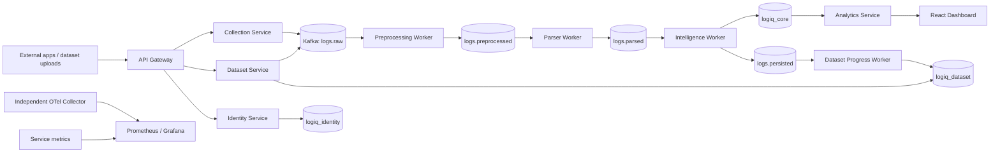

# LogIQ architecture

## Database ownership

- `logiq_identity`: owned by Identity; users, tenants, applications and API keys.
- `logiq_dataset`: owned by Dataset; dataset metadata, processing attempts and progress idempotency ledger.
- `logiq_core`: currently shared by Collection, Preprocessing, Parser, Intelligence and Analytics for log events, template registry and anomalies.

The Dataset API and Dataset progress worker use the Dataset-owned database. Intelligence does not update Dataset rows. It publishes a persisted-log notification after its core database transaction; the Dataset progress worker consumes the notification and applies an idempotent update. Generic stage failures are first written to the relevant DLQ and then published as dataset failure notifications. Retry attempts are versioned so delayed messages from older attempts cannot update the current dataset run.

Each database has its own Alembic migration gate in Compose. `migrate`, `migrate-identity` and `migrate-dataset` run before their respective service groups.

## Event flow

1. HTTP ingestion (`POST /v1/logs`) or Dataset upload publishes versioned events to `logs.raw`.
2. Preprocessing worker consumes `logs.raw`, normalizes severity/message and publishes `logs.preprocessed`.
3. Parser worker extracts a deterministic token-mask template and publishes `logs.parsed`.
4. Intelligence worker persists parsed events and anomaly records in `logiq_core`, then publishes `log_persisted` to `logs.persisted`.
5. Dataset progress worker consumes `logs.persisted` and updates `logiq_dataset` for dataset-backed events.
6. Analytics reads log events, templates and anomalies from `logiq_core`; Dataset APIs read dataset metadata from `logiq_dataset`.

Delivery is at-least-once. Log event IDs and dataset progress event IDs are idempotency keys. Kafka topic publication and PostgreSQL writes are not yet protected by a transactional outbox; the worker retry path mitigates some failure windows but does not provide exactly-once semantics.

## Remaining architecture work

Collection, Preprocessing, Parser, Intelligence and Analytics still share `logiq_core`. The next database-ownership increments should separate Intelligence and Analytics, then give Collection and Parser/Preprocessing their own persistence only where they need durable service-owned state. A full Docker runtime, Kafka/PostgreSQL integration test, frontend build and independent self-observability failure test remain outstanding.
